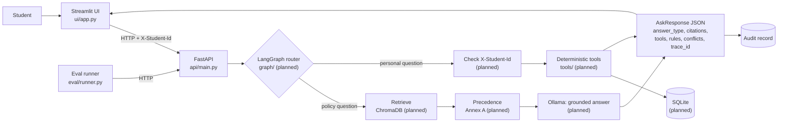

# University Student Services Assistant

HCLTech AI Engineer Hackathon prototype. A student asks questions in a Streamlit chat; a FastAPI
backend answers university-policy questions from authorised documents (with citations) and
student-specific questions with deterministic Python tools over SQLite.

> **Status (2026-10-23):** this branch holds Member 3's UI, evaluation set, evaluation runner,
> tests and docs. The backend (`api/`, `graph/`, `rag/`, `tools/`, `db/`) is owned by Members 1
> and 2 and was not on `main` when this was written. Sections marked *planned* describe the
> agreed design, not verified behaviour. See [docs/known_limitations.md](docs/known_limitations.md).

## What it does

- **Intended users:** students checking policies (attendance, exams, placements) and their own
  attendance, results, backlogs and eligibility.
- **Policy questions** → retrieval from persisted ChromaDB → Annex A precedence → grounded answer
  with citations (doc_id, section/page, version, effective date). *(planned, Member 1)*
- **Personal questions** → identity from the `X-Student-Id` header → deterministic tools over
  SQLite; thresholds from `rule_registry`. *(planned, Member 2)*
- **No evidence** → `not_found` with exactly: `I could not find this information in the authorised university sources.`
- **Every response** carries a `trace_id` with an audit record at `GET /audit/{trace_id}`.

### Security limitations of the prototype

- `X-Student-Id` is the hackathon's agreed identity mechanism. **It is not authentication**:
  anyone who can reach the API can send any ID. A real deployment needs SSO/tokens.
- Student IDs written inside a question are never trusted (UI and eval check this).
- All student data is synthetic. Do not load real student records.

## Architecture



More detail: [docs/architecture.md](docs/architecture.md).

## Setup (Windows PowerShell, native — no Docker)

```powershell
git clone https://github.com/tarunyadav13/CodeForge.git
cd CodeForge
python -m venv .venv
.\.venv\Scripts\Activate.ps1      # if blocked: Set-ExecutionPolicy -Scope Process -ExecutionPolicy Bypass
pip install -r requirements.txt
```

`requirements.txt` is a shared file. Member 3's code needs `streamlit`, `requests` and `pytest`
(see [docs/integration_requests.md](docs/integration_requests.md)).

If the backend uses Ollama (planned, Member 1), install Ollama from https://ollama.com and pull the
model once; it is not bundled and the download is several GB:

```powershell
ollama pull llama3.1:8b
```

## Run

```powershell
# Terminal 1: API
uvicorn api.main:app --reload --port 8000

# Terminal 2: UI (opens http://localhost:8501)
streamlit run ui/app.py
```

## Configuration

| Variable | Used by | Default | Meaning |
|---|---|---|---|
| `API_BASE_URL` | UI, eval runner, live tests | `http://localhost:8000` | Where the FastAPI app listens. Also editable in the UI sidebar. |
| `ASK_TIMEOUT_SECONDS` | UI, eval runner | `120` | Read timeout for `POST /ask` (local LLMs are slow). |
| `INGEST_TIMEOUT_SECONDS` | UI | `300` | Read timeout for `POST /ingest`. |
| `M3_LIVE_API` | tests | unset | Set to `1` to run `tests/test_m3_live_api.py` against a running API. |
| `M3_LIVE_STUDENT_ID`, `M3_LIVE_OTHER_STUDENT_ID` | tests | `S1001`, `S1002` | Synthetic IDs used by the live tests. |

Backend settings (Ollama model, SQLite path, ChromaDB path `data/chroma/`) belong to Members 1
and 2 and will be documented here once their code lands. Never commit `.env` or `data/chroma/`.

## UI features

Chat with history and a "New conversation" button; student ID (sent only as the header); optional
as-of date; colour-coded answer-type badge; citation table; tool input/output tables; applied rules;
resolved vs **unresolved** conflicts; copyable trace ID; health strip (API, vector store, SQLite,
LLM); Sources tab (`GET /sources`); Audit tab (`GET /audit/{trace_id}`); Ingest tab
(`POST /ingest`, shows the backend's real status and chunk count, or "not implemented" on 501).
When the API fails the UI shows the error and no answer.

## API examples

IDs below are illustrative synthetic placeholders.

```powershell
Invoke-RestMethod http://localhost:8000/health

Invoke-RestMethod -Method Post http://localhost:8000/ask `
  -Headers @{ "X-Student-Id" = "S1001" } -ContentType "application/json" `
  -Body '{"question": "What is my attendance in CS201?", "as_of_date": "2026-10-01"}'

Invoke-RestMethod http://localhost:8000/sources
Invoke-RestMethod http://localhost:8000/audit/<trace_id from /ask>

# /ingest: multipart file + metadata JSON (Annex B fields). Field names "file" and "metadata"
# are the UI's assumption until api/main.py implements the endpoint.
curl.exe -X POST http://localhost:8000/ingest `
  -F "file=@docs\sample.pdf" `
  -F 'metadata={"doc_id":"SYN-NOTICE-01","title":"Sample notice","issuer":"Registrar","authority_level":3,"doc_type":"notice","version":"1","effective_from":"2026-10-01","provenance":"synthetic","retrieved_on":"2026-10-23","synthetic":"Y"}'
```

## Tests and evaluation

```powershell
python -m pytest -q                                   # mocked tests, no backend or Ollama needed
$env:M3_LIVE_API = "1"; python -m pytest -q tests/test_m3_live_api.py   # needs the API running

python eval/runner.py --validate-only                 # check eval/eval_set.jsonl
python eval/runner.py --audit                         # run all cases against API_BASE_URL
python eval/runner.py --ids EV-005,EV-021             # a subset
```

The runner writes `eval/results/eval_<timestamp>.json` and exits non-zero if any case fails.
Details, metric definitions and what is N/A: [docs/evaluation.md](docs/evaluation.md).

### Results

No evaluation has been run against the real backend yet, so there are no measured results to
report. This section will only ever contain numbers copied from a runner output file.

## Documentation

[Architecture](docs/architecture.md) · [Evaluation](docs/evaluation.md) ·
[Demo script](docs/demo_script.md) · [Known limitations](docs/known_limitations.md) ·
[Integration requests](docs/integration_requests.md) · [Data card](docs/data_card.md) ·
[AI usage disclosure](docs/ai_usage_disclosure.md) · [Contribution statement](docs/contribution_statement.md)
