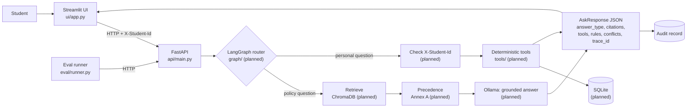

# University Student Services Assistant

HCLTech AI Engineer Hackathon prototype. A student asks questions in a Streamlit chat; a FastAPI
backend answers university-policy questions from authorised documents (with citations) and
student-specific questions with deterministic Python tools over SQLite.

> **Status (2026-10-23): integrated.** Members 1, 2 and 3 are merged on `integration/all-members`: the Streamlit UI
> calls the real FastAPI app, which uses SQLite tools (Member 2) and the RAG + LangGraph policy workflow (Member 1).
> What was and was not verified is listed below and in [docs/known_limitations.md](docs/known_limitations.md).

## What is implemented, mocked or unverified (2026-10-23)

| Item | Status |
|---|---|
| FastAPI app: `/ask`, `/ingest`, `/health`, `/sources`, `/audit/{trace_id}` (`api/`) | **Implemented and exercised end to end** on a running Uvicorn server (see "Verified" below) |
| SQLite schema, deterministic tools, student CSV loader, identity checks, persistent audit | **Implemented**, covered by Member 2's 332 tests and the live run |
| ChromaDB ingestion and retrieval, Annex A precedence (`rag/`), policy workflow (`graph/`, LangGraph) | **Implemented**; offline tests plus a live run with the real `all-MiniLM-L6-v2` embedder |
| Streamlit UI (`ui/`) | **Implemented**; rendered against the running API with Streamlit's `AppTest` |
| LLM wording of answers | **Optional.** Without `OPENAI_API_KEY` (or with `MOCK_LLM=true`) the answer is the cited text itself, and the response says so. **Not validated live in this integration run** |
| Ollama | **Not implemented.** The code has an OpenAI client and an offline mock only |
| Real PDFs in the corpus | **Not ingested:** their `effective_from` is unknown (`data/README.md`) |
| Evaluation | Live run against the synthetic corpus only: **21 of 30 cases pass** (see "Verified") |

## What it does

- **Intended users:** students checking policies (attendance, exams, placements) and their own
  attendance, results, backlogs and eligibility.
- **Policy questions** → retrieval from persisted ChromaDB → Annex A precedence → grounded answer
  with citations (doc_id, section/page, version, effective date). *(planned, Member 1)*
- **Personal questions** → identity from the `X-Student-Id` header → deterministic tools over
  SQLite; thresholds from `rule_registry`. *(planned, Member 2)*
- **No evidence** → `not_found` with exactly: `I could not find this information in the authorised university sources.`
- **Every response** carries a `trace_id` with an audit record at `GET /audit/{trace_id}`.

### Security limitations of the prototype

- `X-Student-Id` is the hackathon's agreed identity mechanism. **It is not authentication**:
  anyone who can reach the API can send any ID. A real deployment needs SSO/tokens.
- Student IDs written inside a question are never trusted (UI and eval check this).
- All student data is synthetic. Do not load real student records.

## Architecture



More detail: [docs/architecture.md](docs/architecture.md).

## Setup (Windows PowerShell, native — no Docker)

```powershell
git clone https://github.com/tarunyadav13/CodeForge.git
cd CodeForge
python -m venv .venv
.\.venv\Scripts\Activate.ps1      # if blocked: Set-ExecutionPolicy -Scope Process -ExecutionPolicy Bypass
pip install -r requirements.txt
```

`requirements.txt` is a shared file. Member 3's code needs `streamlit`, `requests` and `pytest`
(see [docs/integration_requests.md](docs/integration_requests.md)).

**LLM:** the shipped clients are OpenAI (Responses API) and an offline mock. There is **no Ollama client**, so no
Ollama setup is needed. With no key set the app still answers, by quoting the cited text (the response says no LLM was
used). To let an LLM phrase answers, set the key in your own shell only:

```powershell
$env:OPENAI_API_KEY = "<your key>"      # never commit it; $env:MOCK_LLM = "true" forces offline mode
```

The first run downloads the embedding model (`sentence-transformers/all-MiniLM-L6-v2`, ~90 MB) from Hugging Face; after
that it is cached and `$env:HF_HUB_OFFLINE = "1"` works.

## Run

```powershell
# 0) once: create the SQLite database and load Member 2's synthetic students (data/student_services.db, git-ignored)
python -m db.data_access --init
python scripts/load_students.py --dir data/synthetic

# 1) Terminal 1: API (run ONE worker: the source-register lock is per process)
uvicorn api.main:app --port 8000

# 2) Terminal 2: UI (http://localhost:8501)
.\.venv\Scripts\Activate.ps1
streamlit run ui/app.py
```

Ingest the policy corpus (once; it persists in `data/chroma/`). Only `.pdf`, `.txt` and `.md` are accepted. The three real
PDFs cannot be ingested until their `effective_from` is filled in (see [data/README.md](data/README.md)); the six
synthetic fixtures can:

```powershell
python scripts/ingest_corpus.py            # reads data/source_register.csv, skips rows without an effective_from
```

or use the "Ingest document" tab in the UI, or `curl.exe -X POST http://127.0.0.1:8000/ingest -F "file=@path	o\doc.md" -F "metadata=<meta.json"`.

Tests and evaluation:

```powershell
python -m pytest -q                                                    # offline: no key, no network, no model download
$env:M3_LIVE_API = "1"; python -m pytest -q tests/test_m3_live_api.py  # needs the API running
python eval/runner.py --audit --base-url http://127.0.0.1:8000         # LIVE evaluation against the running API
```

## Configuration

| Variable | Used by | Default | Meaning |
|---|---|---|---|
| `API_BASE_URL` | UI, eval runner, live tests | `http://localhost:8000` | Where the FastAPI app listens. Also editable in the UI sidebar. |
| `ASK_TIMEOUT_SECONDS` | UI, eval runner | `120` | Read timeout for `POST /ask` (local LLMs are slow). |
| `INGEST_TIMEOUT_SECONDS` | UI | `300` | Read timeout for `POST /ingest`. |
| `M3_LIVE_API` | tests | unset | Set to `1` to run `tests/test_m3_live_api.py` against a running API. |
| `M3_LIVE_STUDENT_ID`, `M3_LIVE_OTHER_STUDENT_ID` | tests | `S1001`, `S1002` | Synthetic IDs used by the live tests. |

Backend settings:

| Variable | Default | Meaning |
|---|---|---|
| `STUDENT_DB_PATH` | `data/student_services.db` | SQLite file (never commit it) |
| `CHROMA_DIR` | `data/chroma` | Persisted vector store and `source_register.json` (never commit it) |
| `OPENAI_API_KEY`, `OPENAI_MODEL`, `OPENAI_TIMEOUT_S` / `OPENAI_TIMEOUT_SECONDS` | none / `gpt-6-luna` / `30` | Optional LLM; see `llm/README.md` |
| `MOCK_LLM` | unset | `true` = offline, no LLM calls |
| `EMBEDDING_MODEL`, `EMBEDDING_BACKEND` | MiniLM / unset | `EMBEDDING_BACKEND=hash` is a test-only stand-in |
| `RAG_MIN_SCORE`, `RAG_TOP_K` | `0.40`, `6` | Retrieval floor (calibrated on 11 synthetic cases, see `rag/retriever.py`) and chunks retrieved |
| `AUDIT_ADMIN_TOKEN`, `INGEST_MAX_BYTES` | unset / 25 MB | Optional audit admin header token; upload size limit |

Never commit `.env`, `data/chroma/`, `data/uploads/` or the SQLite file.

## Verified in the integration run (2026-10-23)

Run on Windows with the real embedding model, a fresh SQLite database and a fresh ChromaDB, `MOCK_LLM=true` (so **no LLM was
involved**). These are measurements, not claims about answer quality with an LLM:

* Offline suite: `python -m pytest tests -q` -> 695+ passed, 8 skipped (opt-in live tests).
* A running Uvicorn server: 6 synthetic documents ingested over HTTP; unchanged re-upload -> `already_ingested`; `.docx` -> 415;
  invalid metadata or an empty document -> 422; the store was reopened after a server restart.
* Member 3's live API tests: 6 passed. Evaluation runner `--audit`: **21 pass / 9 fail of 30**; latency p50 26 ms, p95 36 ms
  (extractive answers, **no LLM latency**); llm_calls/tokens N/A because no LLM was used.
* The 9 failures: 2 near-topic unanswerable questions (a score floor cannot reject them; they need the LLM answerability check,
  not exercised here); 2 multi-step personal cases whose tool routing is Member 2's (fixtures marked pending); 1 case whose
  forbidden-string check matches `0%` inside `80%` (an evaluation-script issue); 1 case that needs the real UGC PDF (not
  ingested); the rest are listed in `eval/results/`-style output of the runner.

## UI features

Chat with history and a "New conversation" button; student ID (sent only as the header); optional
as-of date; colour-coded answer-type badge; citation table; tool input/output tables; applied rules;
resolved vs **unresolved** conflicts; copyable trace ID; health strip (API, vector store, SQLite,
LLM); Sources tab (`GET /sources`); Audit tab (`GET /audit/{trace_id}`); Ingest tab
(`POST /ingest`, shows the backend's real status and chunk count, or "not implemented" on 501).
When the API fails the UI shows the error and no answer.

## API examples

IDs below are illustrative synthetic placeholders.

```powershell
Invoke-RestMethod http://localhost:8000/health

Invoke-RestMethod -Method Post http://localhost:8000/ask `
  -Headers @{ "X-Student-Id" = "S1001" } -ContentType "application/json" `
  -Body '{"question": "What is my attendance in CS201?", "as_of_date": "2026-10-01"}'

Invoke-RestMethod http://localhost:8000/sources
Invoke-RestMethod http://localhost:8000/audit/<trace_id from /ask>

# /ingest: multipart "file" + "metadata" (JSON of the Annex B fields). The field names are the UI's
# assumption until api/main.py implements the endpoint. Windows PowerShell 5.1 strips double quotes
# when calling native programs, hence the -replace.
$meta = '{"doc_id":"SYN-CIRC-ATT-80","title":"Synthetic Test Circular: Revised Attendance Threshold","issuer":"Synthetic Test University, Office of the Registrar (fictional)","authority_level":2,"doc_type":"circular","version":"1.0","effective_from":"2026-07-01","supersedes":"SYN-REG-ATT-75","scope_programmes":"ALL","scope_batches":"ALL","provenance":"SYNTHETIC test fixture","retrieved_on":"2026-10-23","synthetic":"Y"}' -replace '"','\"'
curl.exe -X POST http://localhost:8000/ingest `
  -F "file=@data\documents\synthetic\SYN-CIRC-ATT-80.md" `
  -F "metadata=$meta"
```

## Tests and evaluation

```powershell
python -m pytest -q                                   # mocked tests, no backend or Ollama needed
$env:M3_LIVE_API = "1"; python -m pytest -q tests/test_m3_live_api.py   # needs the API running

python eval/runner.py --validate-only                 # check eval/eval_set.jsonl
python eval/runner.py --mock                          # MOCK-ONLY replay; does not measure the assistant
python eval/runner.py --audit                         # LIVE: run all cases against API_BASE_URL
python eval/runner.py --ids EV-005,EV-021             # a subset
```

The runner writes `eval/results/eval_<timestamp>.json` and exits non-zero if any case fails.
Details, metric definitions and what is N/A: [docs/evaluation.md](docs/evaluation.md).

### Results

**Live: none.** No evaluation has been run against the real backend, so there are no measured
results to report. This section will only ever contain numbers copied from a runner output file.

**Mock (2026-10-23): MOCK-ONLY.** `python eval/runner.py --mock` replays each case's own expected
answer, so 30/30 pass by construction; that checks the dataset and scoring code, not the assistant.
Latency, retrieval hit rate, LLM calls and tokens are N/A. See [docs/evaluation.md](docs/evaluation.md).

## Documentation

[Architecture](docs/architecture.md) · [Evaluation](docs/evaluation.md) ·
[Demo script](docs/demo_script.md) · [Known limitations](docs/known_limitations.md) ·
[Integration requests and checklist](docs/integration_requests.md) · [Data card](docs/data_card.md) ·
[Corpus and Source Register](data/README.md) · [Sample audit records](docs/sample_audit_records.json) ·
[AI usage disclosure](docs/ai_usage_disclosure.md) · [Contribution statement](docs/contribution_statement.md)
